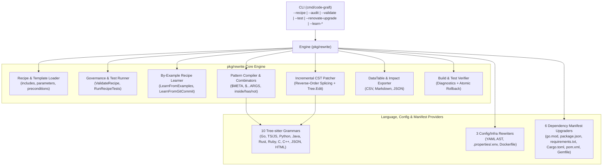

# Architecture & Go SDK Reference

This document details the internal architecture of `code-graft`, how its incremental Concrete Syntax Tree (CST) patcher and pattern compiler work under the hood, how to add new Tree-sitter language grammars, and how to embed `pkg/rewrite` directly as a Go SDK.

---

## Table of Contents

1. [System Architecture Overview](#1-system-architecture-overview)
2. [Lossless Byte-Span Patching & Incremental Re-Parsing](#2-lossless-byte-span-patching--incremental-re-parsing)
3. [Code-Snippet Pattern Compiler & CST Unifier](#3-code-snippet-pattern-compiler--cst-unifier)
4. [Tier 1 Intra-File Scope Model & Extending Languages](#4-tier-1-intra-file-scope-model--extending-languages)
5. [Go SDK API Reference (`pkg/rewrite`)](#5-go-sdk-api-reference-pkgrewrite)

---

## 1. System Architecture Overview



---

## 2. Lossless Byte-Span Patching & Incremental Re-Parsing

Unlike standard AST code generators that pretty-print an entire syntax tree (destroying original developer comments, blank lines, and custom formatting), `code-graft` treats the source file as an immutable byte array paired with a live `*tree_sitter.Tree` (`pkg/rewrite/patcher.go`).

### Multi-Pass Incremental Pipeline

1. **Match Collection:** For a given rule, `code-graft` traverses the CST and collects non-overlapping `Edit` spans (`StartByte`, `EndByte`, `StartPoint`, `EndPoint`, `Replacement`).
2. **Indentation Alignment (`alignIndentation`):** If a replacement string spans multiple lines, `code-graft` inspects the leading whitespace of the line containing `StartByte` and indents lines `2..N` of the replacement to match.
3. **Reverse-Order Splicing (`ApplyEdits`):** Edits are sorted descending by `StartByte` (`b.StartByte < a.StartByte`). Applying splices from the end of the file toward the beginning guarantees that earlier byte offsets remain valid throughout the pass.
4. **Incremental CST Update (`Tree.Edit` + `Parser.Parse`):** For each edit, `code-graft` computes the `tree_sitter.InputEdit` (`StartByte`, `OldEndByte`, `NewEndByte`, `StartPosition`, `OldEndPosition`, `NewEndPosition`), calls `d.tree.Edit(&inputEdit)`, and finally calls `d.parser.Parse(d.source, d.tree)`. Tree-sitter reuses all unchanged subtrees in `O(log N)` time so the next rule in the recipe immediately sees an accurate, updated CST.

---

## 3. Code-Snippet Pattern Compiler & CST Unifier

Tree-sitter grammars do not natively understand `$META` or `$...ARGS` syntax. `pkg/rewrite/pattern.go` bridges this gap with a 3-step compilation and unification pipeline:

### Step 1: Placeholder Sanitization
Before invoking the target language's Tree-sitter parser on a `match` snippet:
* `$...ARGS` is rewritten to a valid identifier `__ts_variadic_ARGS__`.
* `$CLIENT` is rewritten to a valid identifier `__ts_meta_CLIENT__`.

### Step 2: Context-Aware Expression Wrapping (`WrapExpression`)
Strict grammars like Go, Java, Rust, C, and C++ only parse full compilation units at the root of a file. If a user writes an expression pattern like `c.GetUser($CTX, $ID)` in Go or `@RequestMapping($...ARGS)` in Java:
1. `CompilePattern` first parses the raw sanitized snippet.
2. If the resulting root node has `HasError()` or `NamedChildCount() == 0`, `CompilePattern` delegates to `provider.WrapExpression(sanitized)` (e.g., wrapping Go expressions in `package _p; func _f() { _ = <snippet> }` or Java annotations in `class _C { <snippet> void _m() {} }`) and extracts the inner expression/statement CST node via `provider.UnwrapExpression(root)`.

### Step 3: Structural CST Unification (`unifyNodes`)
During matching, `unifyNodes(patternNode, targetNode)` walks both CSTs simultaneously:
* **Single Metavariable (`__ts_meta_<NAME>__`):** Binds `NAME` to `targetNode.Utf8Text(targetSrc)`. If `NAME` was already bound earlier in the same match or in a parent combinator, `unifyNodes` verifies that the normalized source text matches the existing binding.
* **Variadic Metavariable (`__ts_variadic_<NAME>__`):** Captures the slice of `0..K` remaining named children in the target container node (`argument_list`, `parameters`, `block`, etc.) and binds `NAME` to the exact byte range spanning from the first captured sibling's `StartByte()` to the last captured sibling's `EndByte()`.
* **Structural Node:** Verifies `patternNode.Kind() == targetNode.Kind()` and recursively unifies all named children and operator tokens.

---

## 4. Tier 1 Intra-File Scope Model & Extending Languages

All 10 Tree-sitter language providers implement `lang.LanguageProvider` defined in `internal/lang/registry.go`:

```go
type LanguageProvider interface {
    Name() string
    Extensions() []string
    Language() *tree_sitter.Language
    WrapExpression(snippet string) (wrapped string, unwrappedNodeFinder func(root *tree_sitter.Node) *tree_sitter.Node)
    AnalyzeScope(tree *tree_sitter.Tree, source []byte) *ScopeInfo
    AddImport(tree *tree_sitter.Tree, source []byte, modulePath string, symbolOrAlias string) (startByte, endByte uint, replacement []byte, ok bool)
    RemoveImport(tree *tree_sitter.Tree, source []byte, modulePath string) (startByte, endByte uint, replacement []byte, ok bool)
}
```

### How `ScopeInfo` Resolves `fromPackage`
`AnalyzeScope` populates two maps per file:
1. `Imports`: Maps local imported symbol or package alias (e.g., `"acmesdk"` or `"AcmeClient"`) to its full module path (`"github.com/acme/sdk-go/v1"` or `"@acme/sdk"`).
2. `VarOrigins`: Maps local variable names (`"c"`, `"client"`) to the imported symbol/package that initialized or typed them (`"acmesdk"` or `"AcmeClient"`).

When a rule specifies `fromPackage: "github.com/acme/sdk-go/v1"` and `targetVar: "CLIENT"`, `ScopeInfo.LookupSymbolPackage(capturedClientText)` checks both `Imports` (for direct package-qualified calls like `acmesdk.NewClient(...)`) and `VarOrigins` (for instance method calls like `c.GetUser(...)`).

---

## 5. Go SDK API Reference (`pkg/rewrite`)

You can embed `code-graft` directly into your own Go services, CI bots, or developer portals by importing `github.com/loganprice/code-graft/pkg/rewrite`.

### Running a Recipe Programmatically

```go
package main

import (
    "fmt"
    "log"

    "github.com/loganprice/code-graft/pkg/rewrite"
)

func main() {
    engine := rewrite.NewEngine()

    // 1. Load a recipe (with optional template parameters)
    recipe, err := rewrite.LoadRecipeWithParams("configs/examples/acme_sdk_v2.yaml", map[string]string{
        "ENV": "prod",
    })
    if err != nil {
        log.Fatalf("load recipe: %v", err)
    }

    // 2. Validate governance & run embedded unit tests
    valRes := engine.ValidateRecipe(recipe)
    if !valRes.Valid {
        log.Fatalf("invalid recipe: %+v", valRes.Issues)
    }
    testReport, err := engine.RunRecipeTests(recipe)
    if err != nil || !testReport.Passed {
        log.Fatalf("recipe tests failed: %+v", testReport)
    }

    // 3. Execute across a directory with verification hooks
    result, err := engine.RunWithOptions(recipe, "./my-repo", rewrite.RunOptions{
        Write:          true,
        AuditOnly:      false,
        VerifyCommands: []string{"go test ./..."},
    })
    if err != nil {
        log.Fatalf("run failed: %v", err)
    }

    fmt.Printf("Modified %d files (%d findings)\n", len(result.FilesChanged), result.Impact.TotalFindings)
}
```

### Learning a Recipe Programmatically from Examples or Git Commits

```go
engine := rewrite.NewEngine()

// Learn from in-memory Before/After pairs
learnRes, err := engine.LearnFromExamples("migrate-acme-v2", []rewrite.ExamplePair{
    {
        FilePath: "orders.go",
        Before:   beforeBytes,
        After:    afterBytes,
    },
})
if err != nil {
    log.Fatal(err)
}

yamlBytes, _ := rewrite.FormatRecipeYAML(learnRes.Recipe)
fmt.Println(string(yamlBytes))
```
