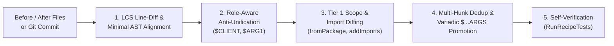

# Enterprise Platform Guide

`code-graft` goes beyond single-file AST find-and-replace to provide an end-to-end **Enterprise Code Modernization Platform**:

1. [Recipe Composition & Organization Playbooks (`includes`)](#1-recipe-composition--organization-playbooks-includes)
2. [Parameterized Recipe Templates (`parameters`, `{{PARAM}}`, `with`)](#2-parameterized-recipe-templates-parameters-param-with)
3. [Preconditions & Repository Filtering (`preconditions`)](#3-preconditions--repository-filtering-preconditions)
4. [Recipe Governance & Embedded Unit Testing (`--validate`, `--test`)](#4-recipe-governance--embedded-unit-testing---validate---test)
5. [Data Tables, Codebase Intelligence & Impact Analysis (`--audit`, `--csv`, `--markdown`)](#5-data-tables-codebase-intelligence--impact-analysis---audit---csv---markdown)
6. [Renovate Bot `postUpgradeTasks` Integration (`--renovate-upgrade`)](#6-renovate-bot-postupgradetasks-integration---renovate-upgrade)
7. [Build & Test Verification Hooks & Atomic Rollback (`--verify-cmd`, `verify`)](#7-build--test-verification-hooks--atomic-rollback---verify-cmd-verify)
8. ["By-Example" Recipe Generator (`--learn-before`/`--learn-after` & `--learn-commit`)](#8-by-example-recipe-generator---learn-before--learn-after----learn-commit)

---

## 1. Recipe Composition & Organization Playbooks (`includes`)

Large migrations (e.g., an org-wide Q4 Platform Modernization) shouldn't be maintained as a single monolithic YAML file. `code-graft` allows recipes to recursively include other recipes via `includes`:

```yaml
name: q4-platform-modernization-playbook
description: Composes Acme SDK v2 migration, Spring Boot 3 upgrade, and org-wide security rules

includes:
  - ./acme_sdk_v2.yaml
  - ./spring_boot_2_to_3.yaml
```

### How Composition Works
* **Relative Path Resolution:** Paths inside `includes` are resolved relative to the directory of the recipe file that declares them.
* **Cycle Detection:** `LoadRecipeWithParams` tracks visited file paths along the inclusion stack and immediately reports an error if a circular dependency (`A -> B -> A`) is detected.
* **Deterministic Rule Ordering:** Included `manifests`, `rules`, `configs`, and `tests` are merged in declaration order before the parent recipe's own rules, allowing a parent playbook to build upon transformations applied by its child recipes.

---

## 2. Parameterized Recipe Templates (`parameters`, `{{PARAM}}`, `with`)

Instead of copying and pasting the same rule boilerplate for 50 internal SDK method renames or package migrations, you can write a single **Parameterized Recipe Template**.

### Defining a Template (`configs/examples/templates/rename_sdk_method.yaml`)

```yaml
name: template-rename-sdk-method-{{OLD_METHOD}}-to-{{NEW_METHOD}}
description: Reusable template for migrating {{OLD_METHOD}} to {{NEW_METHOD}}

parameters:
  - name: LANGUAGE
    description: Target language (go, typescript, python, java, rust, ruby)
    required: true
  - name: OLD_PACKAGE
    description: Old package/module path for Tier 1 scope verification
    required: true
  - name: NEW_PACKAGE
    description: New package/module path to add to imports
    required: true
  - name: NEW_SYMBOL
    description: Imported symbol or package alias
    default: ""
  - name: OLD_METHOD
    description: Method name to match on receiver
    required: true
  - name: NEW_METHOD
    description: Replacement method name on receiver
    required: true

rules:
  - id: rename-{{LANGUAGE}}-{{OLD_METHOD}}-to-{{NEW_METHOD}}
    language: "{{LANGUAGE}}"
    match: "$CLIENT.{{OLD_METHOD}}($...ARGS)"
    replace: "$CLIENT.{{NEW_METHOD}}($...ARGS)"
    fromPackage: "{{OLD_PACKAGE}}"
    targetVar: "CLIENT"
    addImports:
      - module: "{{NEW_PACKAGE}}"
        symbol: "{{NEW_SYMBOL}}"
    removeImports:
      - "{{OLD_PACKAGE}}"
```

### Instantiating a Template in Two Ways

#### Way A: Repeatedly inside a Parent Playbook (`includes` with `with`)
A parent recipe can instantiate the same template multiple times with different `with` parameter maps:

```yaml
name: acme-multi-method-migration
includes:
  - path: ./templates/rename_sdk_method.yaml
    with:
      LANGUAGE: go
      OLD_PACKAGE: github.com/acme/sdk-go/v1
      NEW_PACKAGE: github.com/acme/sdk-go/v2
      NEW_SYMBOL: acmesdk
      OLD_METHOD: GetUser
      NEW_METHOD: FetchUser

  - path: ./templates/rename_sdk_method.yaml
    with:
      LANGUAGE: go
      OLD_PACKAGE: github.com/acme/sdk-go/v1
      NEW_PACKAGE: github.com/acme/sdk-go/v2
      NEW_SYMBOL: acmesdk
      OLD_METHOD: DeleteUser
      NEW_METHOD: RemoveUser
```

#### Way B: Directly from the CLI (`--param KEY=VALUE`)
```bash
code-graft --recipe configs/examples/templates/rename_sdk_method.yaml \
  --param LANGUAGE=typescript \
  --param OLD_PACKAGE=@acme/sdk \
  --param NEW_PACKAGE=@acme/sdk-v2 \
  --param NEW_SYMBOL=AcmeV2Client \
  --param OLD_METHOD=getUser \
  --param NEW_METHOD=fetchUser \
  --dir ./services/checkout --write
```

---

## 3. Preconditions & Repository Filtering (`preconditions`)

When running recipes across hundreds of repositories, `preconditions` let `code-graft` skip inapplicable repositories or directories in microseconds:

```yaml
preconditions:
  # Repo-level guard: All listed file patterns must exist in the workspace root (or subdirectories),
  # otherwise the entire recipe is skipped immediately.
  requiredFiles:
    - "go.mod"

  # File-level whitelist: Only scan files matching at least one glob pattern.
  filePatterns:
    - "*.go"
    - "go.mod"
    - "application*.yml"

  # File-level blacklist: Never touch files matching these patterns.
  excludeFiles:
    - "*_mock.go"
    - "**/testdata/**"
    - "**/*.pb.go"
```

---

## 4. Recipe Governance & Embedded Unit Testing (`--validate`, `--test`)

In an enterprise platform, recipes are production code and must be validated in CI before being rolled out across repositories.

### 1. Static Recipe Validation (`--validate`)
Running `code-graft --recipe <file.yaml> --validate` performs static verification on every rule and config entry:
* Verifies the `language` provider exists in the registry.
* Compiles every `match` and combinator `pattern` into a Tree-sitter CST to ensure zero syntax errors.
* Verifies that every `$META` or `$...ARGS` referenced in `replace`, `where`, or `transforms` is actually bound in `match` (or in positive `inside`/`has`/`follows`/`precedes`/`all` combinators, or produced by an earlier `transforms` step).
* Validates all regular expressions in `where` and `transforms`.

### 2. Embedded In-Memory Unit Testing (`--test`)
Every recipe can embed self-contained `tests` cases that execute completely in memory via `code-graft --recipe <file.yaml> --test`:

```yaml
tests:
  - name: migrates Go SDK v1 client and ignores unrelated GetUser calls
    language: go
    before: |
      package app
      import (
          "context"
          acmesdk "github.com/acme/sdk-go/v1"
      )
      func Run(ctx context.Context, other OtherClient) {
          c := acmesdk.NewClient("secret")
          _, _ = c.GetUser(ctx, "u-1")
          _, _ = other.GetUser(ctx, "u-1")
      }
    after: |
      package app
      import (
          "context"
          acmesdk "github.com/acme/sdk-go/v2"
      )
      func Run(ctx context.Context, other OtherClient) {
          c := acmesdk.NewV2Client(acmesdk.Config{Token: "secret"})
          _, _ = c.FetchUser(ctx, "u-1", nil)
          _, _ = other.GetUser(ctx, "u-1")
      }
```

If a test fails, `code-graft --test` prints a unified diff between the expected `after` snippet and the actual rewritten output and exits with a non-zero status code.

---

## 5. Data Tables, Codebase Intelligence & Impact Analysis (`--audit`, `--csv`, `--markdown`)

Inspired by OpenRewrite's Data Tables, every run of `code-graft` (whether in `--audit`, `--dry-run`, or `--write` mode) collects structured row-level findings (`DataTableRow`) and aggregates an executive `ImpactSummary`.

### Row Schema (`DataTableRow`)

| Column | Description |
| :--- | :--- |
| `filePath` | Workspace-relative file path (`service.go`, `pom.xml`, `application.yml`). |
| `language` | Language, config engine, or manifest type (`go`, `java`, `yaml`, `go.mod`). |
| `category` | `"cst_rule"`, `"config_rule"`, or `"manifest_upgrade"`. |
| `ruleId` | ID of the rule that matched (`go-client-get-user`, `manifest:go.mod:github.com/acme/sdk-go/v1`). |
| `line` / `column` | 1-based start line and column of the match in the original file. |
| `matchedText` | Single-line preview of the original matched code or dependency. |
| `replacementText` | Single-line preview of the replacement code or upgraded dependency. |
| `packageScope` | Verified Tier 1 `fromPackage` origin (if applicable). |
| `captures` | Map of metavariable bindings (`{"$CLIENT": "c", "$ID": "userID"}`). |

### Exporting CSV & Markdown Reports

```bash
# Run read-only discovery across a repo and emit both CSV and Markdown reports
code-graft --recipe configs/examples/spring_boot_2_to_3.yaml \
  --dir ./my-spring-service \
  --audit \
  --csv spring_boot_3_findings.csv \
  --markdown spring_boot_3_impact.md
```

The generated Markdown report includes:
* Total files scanned vs. affected, total findings, and estimated manual engineering minutes saved (`EstimatedEffortMinutes`).
* Breakdown tables by **Rule ID**, **Language / Ecosystem**, and **File**.
* A sample findings table with `file:line`, `ruleId`, `matchedText`, and `replacementText`.

---

## 6. Renovate Bot `postUpgradeTasks` Integration (`--renovate-upgrade`)

When Renovate Bot bumps a major version in `go.mod`, `package.json`, `pom.xml`, `Cargo.toml`, `requirements.txt`, or `Gemfile`, the PR will fail CI if breaking API calls aren't migrated at the same time.

`code-graft` integrates directly with Renovate's `postUpgradeTasks` via `--renovate-upgrade`:

### Step 1: Tag Recipes with `targetDependency`
```yaml
targetDependency:
  ecosystem: gomod          # Optional: gomod, npm, pypi, maven, cargo, bundler
  name: github.com/acme/sdk-go
  versionPrefix: "v2"       # Matches v2.0.0, v2.4.1, ^2.0.0, etc.
```

### Step 2: Configure `renovate.json` (`configs/examples/renovate.json`)
```json
{
  "$schema": "https://docs.renovatebot.com/renovate-schema.json",
  "packageRules": [
    {
      "matchUpdateTypes": ["major", "minor"],
      "postUpgradeTasks": {
        "commands": [
          "code-graft --renovate-upgrade '{{{depName}}}@{{{newVersion}}}' --recipes-dir configs/examples --dir . --write"
        ],
        "fileFilters": ["**/*"],
        "executionMode": "branch"
      }
    }
  ]
}
```

When Renovate upgrades `github.com/acme/sdk-go/v1` to `v2.4.0`, `code-graft` scans `--recipes-dir`, discovers all recipes matching `github.com/acme/sdk-go@v2.4.0`, and rewrites all call sites in the Renovate branch before the PR is opened!

---

## 7. Build & Test Verification Hooks & Atomic Rollback (`--verify-cmd`, `verify`)

To guarantee that automated rewrites never leave a repository in a non-compiling state, `code-graft` supports post-rewrite verification commands with **structured compiler diagnostic extraction** and **atomic file rollback**.

### Configuring Verification in YAML or CLI

In the recipe YAML:
```yaml
verify:
  commands:
    - "go build ./..."
    - "go test ./..."
  timeoutSeconds: 120
  rollbackOnFailure: true
```

Or via CLI flags:
```bash
code-graft --recipe configs/examples/acme_sdk_v2.yaml \
  --dir ./my-service \
  --write \
  --verify-cmd "go build ./..." \
  --verify-cmd "go test ./..."
```

### What Happens When Verification Runs
1. `code-graft` snapshots the original bytes and file permissions of every modified file in memory before writing changes to disk.
2. Each verification command executes sequentially in the target workspace directory.
3. If any command exits with a non-zero status code:
   * `code-graft` parses the compiler/test output into structured `CompilerDiagnostic` items (`file`, `line`, `column`, `severity`, `message`) across Go, TypeScript (`tsc`), Java (`javac`/Maven), Rust (`rustc`/`cargo`), and Python.
   * If `rollbackOnFailure` is enabled (the default), `code-graft` **atomically restores every modified file on disk back to its exact pre-rewrite state** and sets `verification.rolledBack = true`.

---

## 8. "By-Example" Recipe Generator (`--learn-before`/`--learn-after` & `--learn-commit`)

Writing migration rules by hand isn't even necessary when a developer has already migrated one file or committed a sample fix. `code-graft` can **learn a complete, self-verified YAML recipe directly from code examples**.

### Usage

```bash
# 1. Learn from one or more Before/After file pairs:
code-graft \
  --learn-before examples/orders_before.go \
  --learn-after examples/orders_after.go \
  --learn-name "acme-v2-learned" \
  --learn-out configs/learned_acme_v2.yaml

# 2. Learn directly from a Git commit (inspects all modified files in the commit):
code-graft \
  --learn-commit HEAD \
  --dir . \
  --learn-out configs/learned_from_head.yaml
```

### How the 5-Stage Synthesis Pipeline Works (`pkg/rewrite/learner.go`)



1. **Hybrid Line-Diff + Minimal Enclosing AST Alignment (`computeLineHunks` & `narrowIdenticalWrapper`):**
   * Computes an LCS line-level diff between the `Before` and `After` sources (ignoring top-level `import`/`#include` lines, which are handled semantically).
   * Locates the smallest enclosing statement/expression CST nodes covering each hunk and peels away identical wrappers (`u1, err := ...`, `const res = ...`, `return ...`) so the rule isolates the exact changed call or expression (`c.GetUser(ctx, "ord-1")` → `c.FetchUser(ctx, "ord-1", nil)`).
2. **Role-Aware Anti-Unification (`generalizeASTPair`):**
   * Preserves method and function names literally while generalizing local receiver variables (`c`) into `$CLIENT` with `targetVar: "CLIENT"`.
   * Queries `beforeScope.LookupSymbolPackage("c")` to automatically populate `fromPackage: "github.com/acme/sdk-go/v1"`.
   * Generalizes shared argument subtrees that appear in both `Before` and `After` into `$ARG1`, `$ARG2`, etc.—even when an argument moves inside an object literal or struct initializer (`acmesdk.NewClient($ARG1)` → `acmesdk.NewV2Client(acmesdk.Config{Token: $ARG1})`).
3. **Automatic Scope & Import Diffing (`diffScopesImports`):**
   * Compares `beforeScope.ImportedPackages()` and `afterScope.ImportedPackages()` to automatically populate `addImports` and `removeImports`.
4. **Multi-Hunk Deduplication & Variadic `$...ARGS` Promotion (`deduplicateAndPromoteVariadic`):**
   * Collapses multiple identical call-site migrations into a single rule.
   * When multiple hunks in the example migrate the same method with different argument counts (e.g., `logger.warn(a)` and `logger.warn(a, b, c)` → `logger.logWarn(...)`), automatically promotes the argument list to variadic `$...ARGS` (`$CLIENT.warn($...ARGS)` → `$CLIENT.logWarn($...ARGS)`).
5. **Automatic Self-Verification (`RunRecipeTests`):**
   * Embeds the `Before` and `After` files inside the generated recipe's `tests` block and immediately executes `Engine.RunRecipeTests` in memory to guarantee that applying the synthesized recipe to `Before` produces the exact `After` output.
